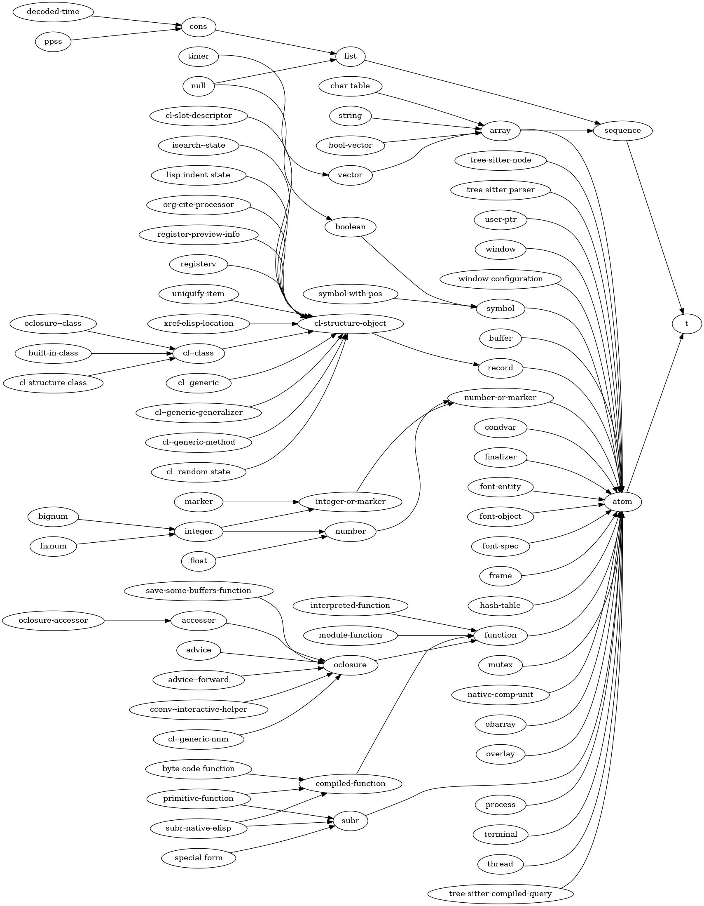

Lisp object types are organized in a hierarchy, which means that types can derive from other types. Objects of type B (which derives from type A) inherit all the characteristics of type A. This also means that every object of type B is at the same time an object of type A from which it derives.

Every type derives from type `t`.

New types can be defined by the user through `defclass` or `cl-defstruct`.

The Lisp Type Hierarchy for primitive types can be represented as follows:

For example type `list` derives from (is a special kind of) type `sequence` which itself derives from `t`.
